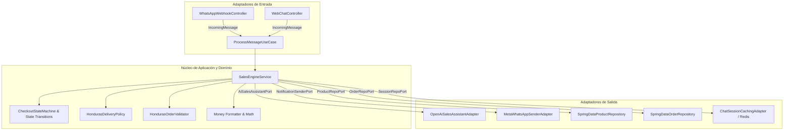
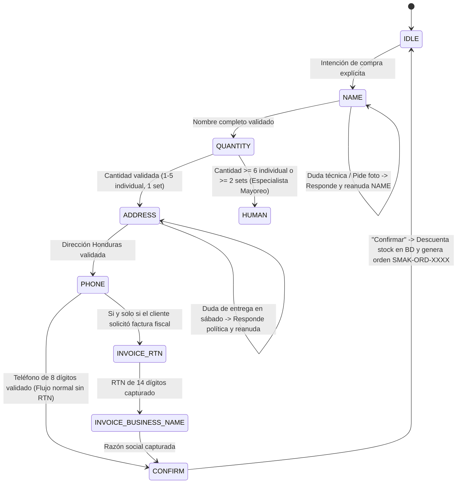
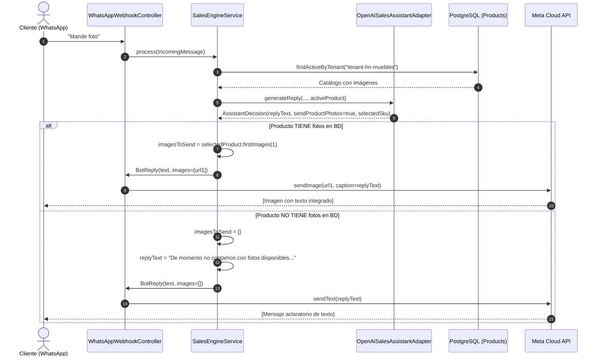
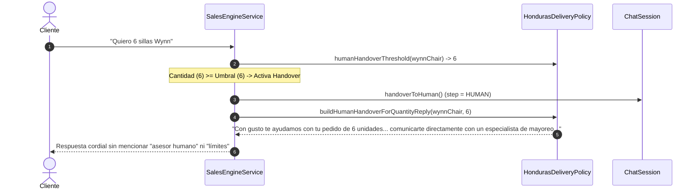

# SDD-BE-002: Motor Conversacional y Políticas Comerciales Backend (Spring Boot 3 / Arquitectura Hexagonal)

- **Documento:** `/docs/sdd/sdd-backend-conversational-engine-v2.md`
- **Módulo:** `backend/smakbot-core`
- **Fase SDOP:** FASE 3 / MANTENIMIENTO CONTINUO Y BLINDAJE
- **Fecha:** 2026-11-14
- **Autor:** Arquitecto de Software Principal & Senior Lead Engineer (SyborX / SDOP Framework)
- **Estado:** VIGENTE / EN PRODUCCIÓN (Hetzner `5.161.82.24`)

---

## 1. Visión General de la Arquitectura Backend

El backend está construido bajo los principios de **Arquitectura Hexagonal (Ports and Adapters)** en **Java 17** y **Spring Boot 3.3.5**, garantizando que la lógica de negocio y las políticas comerciales de Honduras residan en el núcleo del dominio, completamente aisladas de los detalles de infraestructura (WhatsApp, OpenAI, PostgreSQL o Redis).



---

## 2. Dominio y Políticas de Negocio (Domain Engine)

### 2.1. `HondurasDeliveryPolicy.java`
Centraliza las reglas no negociables de la empresa en Honduras:

```java
// Principales responsabilidades y métodos deterministas:
public final class HondurasDeliveryPolicy {
    // 1. Zonas y SLAs de entrega Cargo Expreso
    public static String computeEstimatedDeliveryDays(String address);
    // Retorna "entre 1 y 2 días hábiles, lo más seguro" para El Progreso, San Pedro Sula,
    // Santa Rosa de Copán, Tegucigalpa, La Ceiba y Choloma.
    // Retorna "entre 2 y 3 días hábiles, lo más seguro" para el resto de Honduras.

    // 2. Protocolo logístico de sábados y fechas específicas
    public static String buildSaturdayReply(String address);
    public static String buildSpecificDateReply(String address);

    // 3. Reglas de volumen y mayoreo diferenciado
    public static boolean isSetOrDualIndividualProduct(Product product, List<Product> catalog);
    public static int humanHandoverThreshold(Product product, List<Product> catalog);
    // SET -> Umbral = 2 unidades
    // Individual -> Umbral = 6 unidades (bot vende 1 a 5)

    // 4. Sanitización extrema (anti-emojis, anti-asteriscos, anti-SKU, anti-muletillas)
    public static String sanitizeCustomerReply(String raw);

    // 5. Manejo transparente de fotos no disponibles
    public static String buildNoPhotosAvailableReply(Product product);
}
```

### 2.2. `HondurasOrderValidator.java`
Asegura la calidad de los datos recopilados antes de confirmar la orden:
- **Nombre:** Requiere nombre y al menos un apellido (`isValidFullName`). Rechaza nombres aislados o alias.
- **Dirección:** Exige ciudad/departamento y referencias de colonia/calle (`isValidHondurasAddress`), o detección de retiro en agencia CAEX o coordenadas GPS nativas.
- **Teléfono:** Valida exactamente 8 dígitos telefónicos de Honduras que comiencen con rangos celulares estándar (ej. 9xxx-xxxx, 8xxx-xxxx, 3xxx-xxxx) (`isValidHondurasPhone`).
- **Facturación / RTN:** Solo valida RTN de 14 dígitos numéricos (`isValidRtn14`) si el cliente activó la bandera de factura fiscal de forma explícita (`explicitInvoiceRequested`).

---

## 3. Máquina de Estados del Checkout y Supresión de Factura Proactiva

El proceso de compra en [SalesEngineService.java](file:///c:/Users/kike2/OneDrive/Escritorio/SWAP/SMAK_chat-bot/smakbot-demo/backend/src/main/java/com/smakbot/core/application/service/SalesEngineService.java) opera como una máquina de estados determinista guiada por la IA pero gobernada por el backend:



---

## 4. Orquestación del Adaptador OpenAI (`OpenAiSalesAssistantAdapter.java`)

### 4.1. Inyección de Catálogo con Metadatos de Fotos
Para evitar contradicciones entre la IA y los medios de la base de datos, el prompt inyecta la disponibilidad exacta de imágenes:
```text
- [ID_INTERNO_NO_MOSTRAR_AL_CLIENTE: ZGM-030-NE-NE] | Nombre: Mesa Auxiliar de Arrime Smak - Acabado Símil Mármol Negro | Precio Actual Fijo: L. 990.00 | Stock: 10 disponibles | Límite traslado asesor: más de 2 unidades (3 o más) | Colores: Negro | Medidas: 45 × 30 × 60 cm | Soporte/Peso: 50 kg | Categoría: Mesas | Fotos en BD: 4 fotos disponibles
```

### 4.2. Esquema JSON Estructurado Estricto
La llamada a la API de OpenAI utiliza el modo `response_format: { type: "json_schema" }` forzando una estructura JSON predecible:
```json
{
  "replyText": "Con gusto te comparto la foto de la Mesa Auxiliar de Arrime Smak...",
  "nextStep": "NAME",
  "selectedSku": "ZGM-030-NE-NE",
  "sendProductPhotos": true,
  "sendAllPhotos": false,
  "cancelCheckout": false,
  "confirmOrderNow": false,
  "draftUpdate": {
    "productSku": "ZGM-030-NE-NE",
    "quantity": 1,
    "customerName": null,
    "deliveryAddress": null,
    "customerPhone": null
  }
}
```

---

## 5. Diagramas de Secuencia de Procesos Clave

### 5.1. Ciclo de Consulta y Envío de Foto ("Mande foto")


### 5.2. Escalación a Especialista de Mayoreo


---

## 6. Persistencia y Almacenamiento

1. **PostgreSQL (`smakbot_db`):**
   - Tablas maestras: `products`, `orders`, `tenants`, `chat_sessions`, `bot_rules`, `campaigns`.
   - Columna `images`: almacenada como array JSON (`jsonb` / `text`) con URLs verificadas (Wix/Cloudinary).
2. **Redis (`smakbot-redis`):**
   - Caché de sesiones con TTL de 24 horas.
   - Control de idempotencia de mensajes de WhatsApp (`wamid`) para prevenir duplicados ante reintentos de Meta.
   - Lista negra de tokens JWT administrativos revocados.

---

## 7. Pruebas y Validación de Dominio

La suite de pruebas en [SalesEngineServiceTest.java](file:///c:/Users/kike2/OneDrive/Escritorio/SWAP/SMAK_chat-bot/smakbot-demo/backend/src/test/java/com/smakbot/core/application/service/SalesEngineServiceTest.java) cubre más de 30 casos de prueba críticos:
- `testQuantityHumanHandoverGeneralVsSetTolix`: Valida umbral de 2 para sets y 6 para individuales.
- `testPhotoRequestWithAndWithoutImages`: Valida entrega de 1 foto en *"Mande foto"* y mensaje transparente si no hay fotos.
- `testHondurasDeliverySLAWindows`: Valida SLA de 1-2 días en las 6 ciudades y 2-3 días en el resto.
- `testSaturdayDeliveryPolicy`: Valida protocolo de sábado con retiro en agencia y pregunta sobre quién recibe.
- `testInvoiceSuppressionAndDirectConfirmation`: Valida transición directa de teléfono a confirmación sin RTN.

