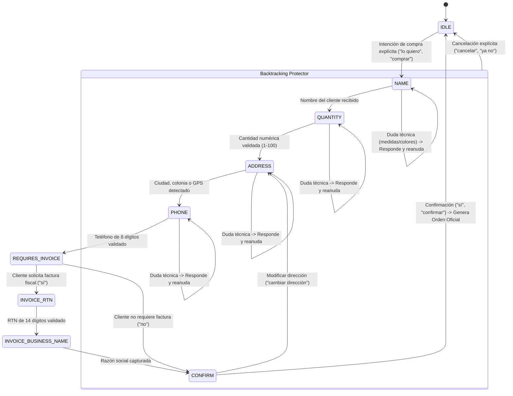

# Documento de Diseño de Software (SDD): Motor Conversacional Comercial y Persona SMAK Muebles Honduras

- **Documento:** `/docs/sdd/sdd-conversational-sales-engine.md`
- **Módulo:** `smakbot-core` (Application Layer / Conversational Sales Engine)
- **Fase SDOP:** FASE 2 / FASE 3 - Plano Técnico Aprobado e Integrado
- **Fecha:** 2026-11-02
- **Autor:** Arquitecto de Software Principal & Senior Lead Engineer (SyborX / SDOP Framework)
- **Estado:** VIGENTE / IMPLEMENTADO Y PROBADO (18 Tests Unitarios de Dominio PASS)

---

## 1. Misión y Propósito Comercial

El motor conversacional de **SMAKBOT** está diseñado exclusivamente para **maximizar la conversión de ventas de comercio electrónico en Honduras para SMAK Muebles**. 

Su comportamiento se homologa bajo los siguientes principios fundamentales:
1. **Claridad y Coherencia:** Respuestas directas, comprensibles, con formato visual estructurado en Markdown (listas con viñetas, negritas, emojis sutiles y llamados a la acción claros).
2. **Calidez Comercial Hondureña:** Trato empático, educado y cercano ("¡Hola! Con mucho gusto te atiendo", "A la orden", "¡Excelente elección!"), erradicando respuestas frías o modismos extranjeros.
3. **Cero Alucinaciones:** Nunca asume compras ante consultas informativas; nunca inventa precios fuera de catálogo; nunca asigna productos al azar.
4. **Respeto a las Políticas del Mercado Catracho:** Envíos 100% gratis a nivel nacional vía Cargo Expreso con pago en efectivo contra entrega; excepción Roatán/Islas de la Bahía con transferencia previa y entrega en muelle de La Ceiba; moneda oficial en Lempiras (`L.`); facturación legal con RTN.

---

## 2. Diagrama de Estados del Checkout con Blindaje (Backtracking)

El proceso de compra se gestiona mediante una máquina de estados finita determinista en [CheckoutStateMachine.java](file:///c:/Users/kike2/OneDrive/Escritorio/SWAP/SMAK_chat-bot/smakbot-demo/backend/src/main/java/com/smakbot/core/application/engine/CheckoutStateMachine.java):

---

## 3. Matriz de Detección de Intenciones ([IntentDetector.java](file:///c:/Users/kike2/OneDrive/Escritorio/SWAP/SMAK_chat-bot/smakbot-demo/backend/src/main/java/com/smakbot/core/application/engine/IntentDetector.java))

| Intención | Expresiones y Disparadores Clave | Comportamiento del Motor |
| :--- | :--- | :--- |
| **Saludo Inicial** | `hola`, `buenas`, `buenos dias`, `buenas tardes` | Da la bienvenida con calidez, presenta las 4 categorías principales con precios base y hace pregunta abierta de asesoría. |
| **Consulta de Catálogo** | `catalogo`, `que productos tienen`, `que venden`, `opciones` | Despliega las líneas principales (Sillas, Taburetes, Escritorios, Lavatrastos) con sus rangos de precios en Lempiras. |
| **Compra Explícita** | `\b(?:lo\|la)\s+quiero\b`, `quiero comprar`, `ordenar`, `hacer pedido` *(Excluye: "quiero saber", "quiero ver", "quiero preguntar")* | Inicia la orden creando un `CheckoutDraft` e ingresa al estado `NAME`. |
| **Preguntas de Producto** | `precio`, `cuanto vale`, `medidas`, `dimensiones`, `colores`, `peso`, `fotos`, `stock`, `garantia` | Consulta el producto activo o candidato y responde con fichas técnicas estructuradas y fotos reales. |
| **Políticas de Honduras** | `roatan`, `utila`, `islas de la bahia`, `envio`, `cargo expreso`, `armado`, `llaves`, `herramientas` | Invoca [HonduranCommercePolicy.java](file:///c:/Users/kike2/OneDrive/Escritorio/SWAP/SMAK_chat-bot/smakbot-demo/backend/src/main/java/com/smakbot/core/application/engine/HonduranCommercePolicy.java) con información exacta de fletes, tiempos de entrega y ensamble. |
| **Cancelación** | `cancelar`, `anular`, `ya no`, `olvidalo`, `reiniciar` | Resetea la sesión a estado `IDLE`, limpia el borrador y ofrece nueva asistencia sin fricción. |
| **Asesor Humano** | `humano`, `asesor`, `agente`, `persona`, `ayuda de alguien` | Transfiere la conversación al asesor dentro del mismo chat, marcando el estado como `HUMAN`. |

---

## 4. Estrategia de Fallback en 2 Pasos (Clarificación y Transferencia)

Para evitar que el cliente quede atrapado en bucles de incomprensión:
1. **Primer Fallback (`fallbackCount = 0 -> 1`):** 
   - El bot responde cordialmente con empatía catracha:
   *"Disculpa, no logré entender bien tu mensajito. 😊 ¿Podrías ser un poquito más claro o decirme qué mueble o producto estás buscando? Con gusto te ayudo a revisarlo."*
2. **Segundo Fallback Consecutivo (`fallbackCount = 1 -> handover`):**
   - El bot transfiere automáticamente la conversación al equipo humano:
   *"Para brindarte una mejor atención, voy a transferir tu consulta directamente con un ejecutivo comercial de nuestro equipo para que te asista de forma personalizada por este mismo chat. Un miembro del equipo te responderá en breve. ¡Muchas gracias por tu paciencia! 🙌"*

---

## 5. Reglas Inviolables para Desarrolladores e Inteligencias Artificiales

1. **PROHIBIDO** modificar los límites de palabras para compra (`\b(?:lo|la)\s+quiero\b`) sin verificar la suite de 18 pruebas unitarias.
2. **PROHIBIDO** asignar un producto predeterminado (`catalog.get(0)`) si el cliente no ha nombrado el mueble deseado.
3. **OBLIGATORIO** preservar todos los precios con el prefijo oficial de Lempiras (`L.`).
4. **OBLIGATORIO** responder dudas y continuar el checkout si el cliente consulta atributos en medio de la captura de datos.
