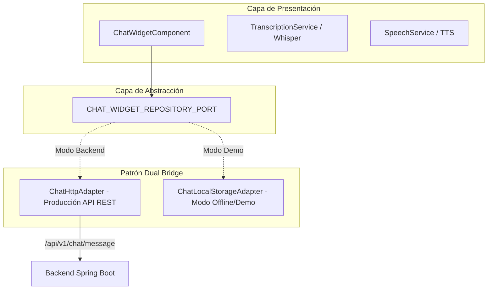
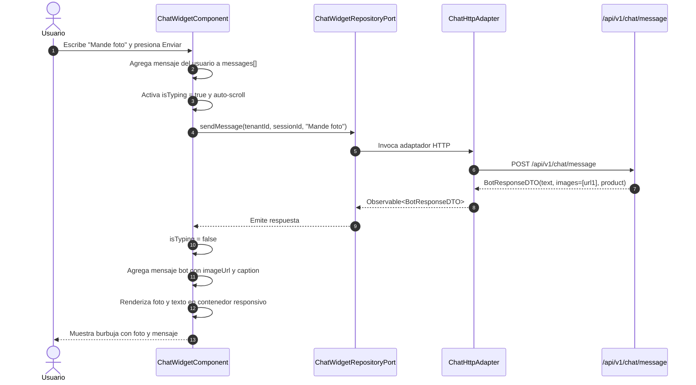

# SDD-FE-002: Arquitectura del Chat Widget y Experiencia del Cliente Frontend (Angular 17+)

- **Documento:** `/docs/sdd/sdd-frontend-chat-widget-v2.md`
- **Módulo:** `frontend/src/app`
- **Fase SDOP:** FASE 3 / INTEGRACIÓN Y PRODUCCIÓN
- **Fecha:** 2026-11-14
- **Autor:** Arquitecto de Software Principal & Senior Lead Engineer (SyborX / SDOP Framework)
- **Estado:** VIGENTE / EN PRODUCCIÓN

---

## 1. Visión General de la Arquitectura Frontend

El frontend está desarrollado en **Angular 17+** con arquitectura de **Componentes Standalone**, tipado estricto en **TypeScript 5.x** y estilizado responsivo con **TailwindCSS / CSS3 nativo**.

Sigue el patrón de **Arquitectura Limpia / Hexagonal en Frontend** mediante el desacoplamiento entre la vista (`ChatWidgetComponent`) y la capa de infraestructura mediante el puerto inyectable `ChatWidgetRepositoryPort`.



---

## 2. Componente Central: `ChatWidgetComponent`

Ubicación: [chat-widget.component.ts](file:///c:/Users/kike2/OneDrive/Escritorio/SWAP/SMAK_chat-bot/smakbot-demo/frontend/src/app/components/chat-widget/chat-widget.component.ts)

### 2.1. Responsabilidades
1. **Renderizado Limpio de Texto (Sanitización Visual):**
   - El widget recibe texto plano sin emojis ni negritas desde el backend.
   - Preserva los saltos de línea naturales (`whitespace-pre-wrap`) para listas y especificaciones técnicas sin recurrir a parsers inseguros de HTML (`innerHTML`).
2. **Visualización de Medios y Fotografías de Productos:**
   - **Imagen Única (Hero Banner):** Si `reply.images.length === 1` o `reply.imageUrl` está presente, renderiza la fotografía dentro de la misma burbuja de mensaje con el texto como pie de imagen (*caption*).
   - **Galería Álbum (Múltiples Fotos):** Si `reply.images.length > 1`, renderiza un carrusel o grilla compacta de miniaturas con modal de ampliación en alta resolución.
   - **Aclaración de Fotos No Disponibles:** Si `images` está vacío, no renderiza contenedores huérfanos de imagen ni spinners infinitos; muestra el texto aclaratorio transparente.
3. **Botones de Acción Rápida (Quick Buttons):**
   - Presenta píldoras interactivas en el paso de confirmación (`"Confirmar pedido"`, `"Modificar datos"`).
4. **Soporte de Entrada por Voz y Lectura TTS:**
   - Grabación de notas de voz vía micrófono en formato WebM/WAV enviadas a Whisper (`TranscriptionService`).
   - Botón de audio para reproducir la respuesta del bot con voz natural en español (`SpeechService`).

---

## 3. Patrón Dual Bridge (Puertos y Adaptadores en Angular)

El frontend cuenta con dos implementaciones intercambiables configuradas en `app.config.ts`:

### 3.1. `ChatHttpAdapter.ts` (Modo Producción Conectado)
- Comunica directamente con el endpoint Spring Boot `/api/v1/chat/message`.
- Inyecta cabeceras de contexto: `X-Tenant-ID` y `X-Session-ID`.
- Mapea la respuesta JSON al modelo unificado `BotResponseDTO`.

```typescript
// Contrato de comunicación
sendMessage(tenantId: string, sessionId: string, message: string, location?: LocationPayload): Observable<BotResponseDTO> {
  const payload: ChatMessageRequest = { message, sessionId, tenantId, location };
  return this.http.post<BotResponseDTO>(`${this.apiUrl}/message`, payload, {
    headers: {
      'X-Tenant-ID': tenantId,
      'X-Session-ID': sessionId
    }
  });
}
```

### 3.2. `ChatLocalStorageAdapter.ts` (Modo Autónomo / Prototipo)
- Ejecuta una máquina de estados determinista local en el navegador del cliente.
- Persiste órdenes y catálogos en `localStorage`.
- Permite demostrar la solución sin conectividad de red ni dependencias de servidor.

---

## 4. Contratos de Datos (Data Transfer Objects)

Ubicación: [chat.models.ts](file:///c:/Users/kike2/OneDrive/Escritorio/SWAP/SMAK_chat-bot/smakbot-demo/frontend/src/app/models/chat.models.ts)

```typescript
export interface BotResponseDTO {
  text: string;               // Texto limpio sanitizado (sin emojis ni negritas)
  step: string;               // IDLE, NAME, QUANTITY, ADDRESS, PHONE, CONFIRM, HUMAN
  imageUrl?: string;          // URL de foto principal (Wix / Cloudinary)
  images?: string[];          // Array de 1 a 5 fotos de producto
  product?: ProductSummaryDTO;// Metadatos del producto activo
  order?: OrderSummaryDTO;    // Resumen de orden si fue confirmada
  buttons?: QuickButtonDTO[]; // Píldoras de confirmación / modificación
}

export interface ProductSummaryDTO {
  sku: string;
  name: string;
  salePrice: number;
  dimensions?: string;
  colors?: string;
  imageUrl?: string;
}

export interface QuickButtonDTO {
  id: string;
  title: string;
  payload: string;
}
```

---

## 5. Diagrama de Interacción de Componentes Frontend



---

## 6. Rendimiento y Compatibilidad Móvil

1. **Lazy Loading de Imágenes:**
   - Las imágenes de productos (``) implementan el atributo nativo `loading="lazy"` para ahorrar consumo de datos móviles en clientes hondureños conectados por 3G/4G.
2. **Auto-Scroll Inteligente:**
   - La directiva `AfterViewChecked` supervisa la carga asíncrona de imágenes y ajusta el `scrollTop` suavemente sin generar parpadeos en pantalla.
3. **Resiliencia ante Errores de Red:**
   - Si la llamada HTTP falla o retorna `500`/`502`, el widget captura el error y despliega un mensaje amigable: *"Tuvimos un inconveniente de conexión. Por favor reintenta tu mensaje o contáctanos por WhatsApp."*

