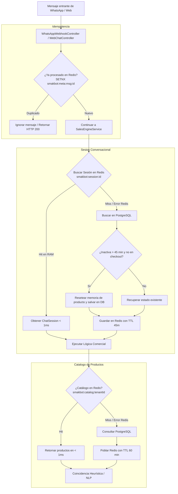

# Documento de Diseño de Software (SDD): Arquitectura de Rendimiento, Caché y Resiliencia con Redis

- **Documento:** `/docs/sdd/sdd-redis-and-performance.md`
- **Módulo:** `smakbot-core` (Infraestructura de Rendimiento y Memoria)
- **Fase SDOP:** FASE 2 / FASE 3 - Plano Técnico Aprobado e Integrado
- **Fecha:** 2026-11-02
- **Autor:** Arquitecto de Software Principal & Senior Lead Engineer (SyborX / SDOP Framework)
- **Estado:** VIGENTE / IMPLEMENTADO Y PROBADO (31 Tests Unitarios PASS)

---

## 1. Objetivos del Sistema de Caché y Rendimiento

1. Reducir la latencia de recuperación del catálogo a **< 1 ms** evitando consultas repetitivas a PostgreSQL.
2. Garantizar la **idempotencia** ante reintentos de webhooks de Meta Graph API.
3. Administrar el ciclo de vida de las sesiones conversacionales con **expiración natural a los 45 minutos** para evitar contaminación de memoria de productos pasados.
4. Proveer un mecanismo de **revocación inmediata de tokens JWT** en el evento de cierre de sesión (`POST /api/v1/auth/logout`).
5. Asegurar **100% Graceful Degradation**: ante cualquier falla, desconexión o reinicio de Redis, el backend continúa operando sin errores contra PostgreSQL.

---

## 2. Mapa de Claves, Formatos y Ciclo de Vida (TTL) en Redis

| Propósito | Formato de Clave | Tipo | Serialización | TTL | Política de Invalidación |
| :--- | :--- | :--- | :--- | :--- | :--- |
| **Catálogo de Productos** | `smakbot:catalog:{tenantId}` | `String` | JSON Array (`List<Product>`) | 60 minutos | Se elimina de inmediato en `save()` y `deleteById()` de [ProductJpaAdapter](file:///c:/Users/kike2/OneDrive/Escritorio/SWAP/SMAK_chat-bot/smakbot-demo/backend/src/main/java/com/smakbot/core/infrastructure/persistence/adapter/ProductJpaAdapter.java). |
| **Idempotencia Meta Webhook** | `smakbot:meta:msg:{messageId}` | `String` | String (`"1"`) | 5 minutos (300 s) | Expiración por tiempo; previene duplicados en ráfagas de reintentos de Meta. |
| **Sesión Conversacional Activa** | `smakbot:session:{sessionId}` | `String` | JSON ([ChatSessionRedisDto](file:///c:/Users/kike2/OneDrive/Escritorio/SWAP/SMAK_chat-bot/smakbot-demo/backend/src/main/java/com/smakbot/core/infrastructure/persistence/dto/ChatSessionRedisDto.java)) | 45 min (Idle) / 24 h (Checkout) | Se renueva con cada interacción. Si expira (> 45 min), el adaptador resetea la memoria de producto. |
| **Blacklist de JWT** | `smakbot:jwt:blacklist:{sha256(token)}` | `String` | String (`"revoked"`) | Tiempo restante de vigencia (`expiration - now`) | Expiración automática al vencerse el tiempo de vida del JWT. |

---

## 3. Diagrama de Flujo de Datos y Resiliencia

---

## 4. Especificación de Clases y Componentes

### 4.1. `RedisConfig.java`
- `@EnableCaching` habilitado.
- Configuración de `RedisTemplate<String, Object>` con `GenericJackson2JsonRedisSerializer` y soporte para módulo JavaTime (`OffsetDateTime`, `Instant`).
- Configuración de `CacheErrorHandler` para degradación elegante: logs de advertencia ante errores de red en lugar de excepciones no controladas.

### 4.2. `ChatSessionCachingAdapter.java`
- Implementa [ChatSessionRepositoryPort](file:///c:/Users/kike2/OneDrive/Escritorio/SWAP/SMAK_chat-bot/smakbot-demo/backend/src/main/java/com/smakbot/core/domain/ports/out/ChatSessionRepositoryPort.java) decorando a [ChatSessionJpaAdapter](file:///c:/Users/kike2/OneDrive/Escritorio/SWAP/SMAK_chat-bot/smakbot-demo/backend/src/main/java/com/smakbot/core/infrastructure/persistence/adapter/ChatSessionJpaAdapter.java) con la anotación `@Primary`.
- Aplica serialización limpia mediante `ChatSessionRedisDto`.
- Aplica TTL dinámico según si el cliente está en checkout (`inCheckout() = 24h`) o en exploración (`45 min`).

### 4.3. `JwtBlacklistService.java`
- Hashea tokens en SHA-256 para evitar almacenamiento de cadenas largas en memoria.
- Método `blacklist(token)` que calcula `getRemainingValidityMilliseconds(token)` y establece el TTL exacto.
- Método `isBlacklisted(token)` invocado en [JwtAuthenticationFilter](file:///c:/Users/kike2/OneDrive/Escritorio/SWAP/SMAK_chat-bot/smakbot-demo/backend/src/main/java/com/smakbot/core/infrastructure/config/security/JwtAuthenticationFilter.java) antes de autenticar al usuario.

---

## 5. Pruebas Unitarias de Certificación

Se certifica el cumplimiento de esta especificación con la ejecución de:
- `WhatsAppIdempotencyServiceTest` (4 pruebas)
- `JwtBlacklistServiceTest` (4 pruebas)
- `ChatSessionCachingAdapterTest` (5 pruebas)
Total: **13 pruebas unitarias específicas de Redis** con 100% de éxito y validación de Graceful Degradation.
